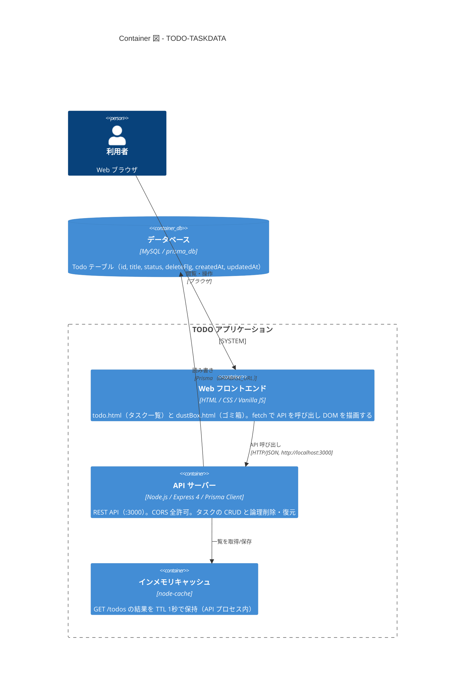

## アーキテクチャ概要

ブラウザ上の素の HTML/JavaScript 画面から、Node.js（Express + Prisma）の REST API（:3000）を経由して MySQL にタスクを保存する学習用 TODO アプリです。



詳細（System Context / Container / Component 図、データフロー、ディレクトリ構成）は [docs/architecture.md](docs/architecture.md) を参照してください。

---

### Nodejs（サーバサイドjavascript）とは
https://qiita.com/non_cal/items/a8fee0b7ad96e67713eb

### CORSとは
https://yamory.io/blog/about-cors/

### DB接続
https://zenn.dev/joo_hashi/articles/98b32113221785

### module化
https://note.affi-sapo-sv.com/nodejs-use-import.php#title3

### cache 導入
- [参考docs](https://pisuke-code.com/node-js-best-memory-cache-module/)
- [npm:node-cache](https://www.npmjs.com/package/node-cache)

### Prsima
- [参考docs](https://www.wadeen.net/posts/ilut7394iwx)
- [MySQLのURL](https://www.prisma.io/docs/orm/overview/databases/mysql)
- [Create User template](https://zenn.dev/tatsuyasusukida/articles/why-prisma-migrate-dev-fails-in-myql)
- [shadow-databaseエラー対応](https://www.prisma.io/docs/orm/prisma-migrate/understanding-prisma-migrate/shadow-database#shadow-database-user-permissions)
    ```
    Prisma Migrate could not create the shadow database. Please make sure the database user has permission to create databases.
    ```